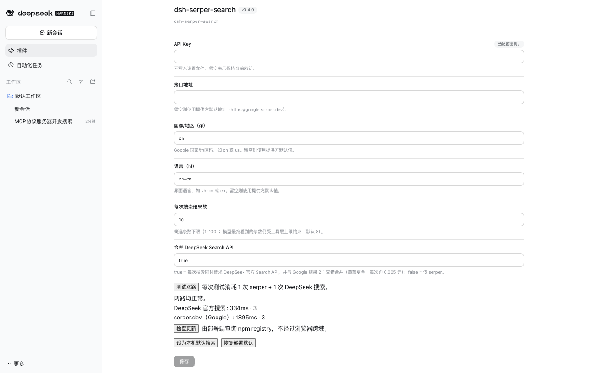
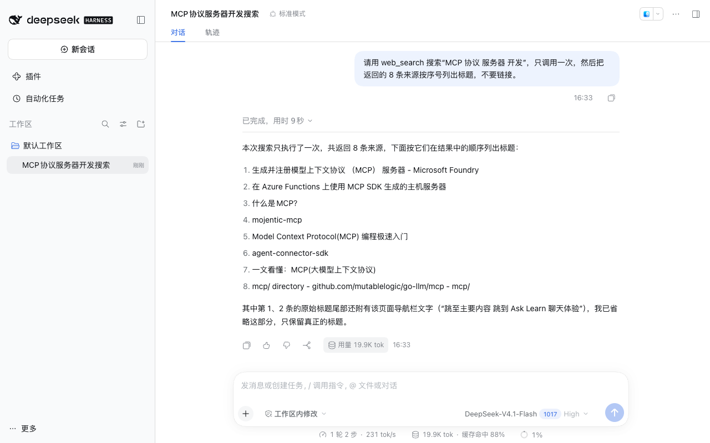

# dsh-serper-search

DeepSeek **Search API**（官方自研搜索引擎）+ [serper.dev](https://serper.dev)（Google 搜索）双擎互补的搜索插件，接入 DeepSeek Harness 的 web 能力缝（`ctx.web`）。安装后，DSH 内置的 `web_search` 每次只发两次直连检索请求（`native:true` 且两路可用时；单路缺 key 或 `native:false` 时只发一次，无辅助模型调用），结果按 URL 去重后以 **固定比例交错**（默认 2:1）合并，让模型同时拿到 DeepSeek 自有索引与 Google 索引。

> 为什么互补：实测同一组 query 下，DeepSeek Search API 与 Google 的结果 URL 重叠仅 **1.3%**（同后端重复调用噪声地板 43%–100%，故为真实索引差异）。DeepSeek 侧更快、更贴中文，Google 侧覆盖面更广，两者互补而不互相替代。
>
> v3 不再调用 DeepSeek 原生 Messages 搜索（旧版那一半每次要一整轮模型调用 5.3s / 0.019 元，且返回的是无摘要裸链接）。

**v0.4.0 起**：成功结果默认缓存 5 分钟（同一 query 重复搜索 0 上游请求）、单路失败按类型冷却并在降级时给模型一行 `Note:`、设置页多出「测试双路 / 检查更新 / 设为本机默认搜索 / 恢复部署默认」四个按钮；**安装后不再需要手改 `cordis.patch.yml`**——首次启动会自动把 `searchProvider` 指向本插件（写入位置与撤销方式见[卸载与恢复](#卸载与恢复)）。

## 截图





> 市场详情页的画廊由仓库根的 `screenshots.json` 声明、夜间构建自动抓取（无需向市场仓库提 PR）；图片本身是 `assets/shot-settings.png` 与 `assets/shot-merged.png`。

## 给 AI 的一句话（最快安装）

把这句话原样发给你的 DSH：

> 安装 dsh-serper-search 并跑一次双路自检，把结果告诉我

Agent 可以按下面五步执行（这也是本节存在的意义：把「装完怎么确认生效」变成一段可复制的话）：

1. 安装：`dsh plugin --profile web add dsh-serper-search`；
2. 配 key（没有 serper key 也能装，只是退化为官方单路）：`~/.dsh/.credentials.yaml` 的 `refs:` 下加 `SERPER_API_KEY: <key>` 与 `DEEPSEEK_API_KEY: <key>`；
3. 重启 `dsh web`（**首次启动会写 pin**），再确认：`dsh --profile web --dump-config | grep -A4 "^- id: web$"`，应看到 `searchProvider: serper`；
4. 新会话调用一次 `web_search`，确认返回 ≥1 条来源；日志（前缀 `web-search-serper:`）里应有 `merged=` 与 `cache=store`；
5. 「测试双路」是 GUI 里的按钮（`POST /api/dsh-serper-search/probe`）：打开 **设置 → 插件 → dsh-serper-search** 点一下，把两行结果（`1234ms · 3`）或错误分类贴回来。Agent 若不能操作浏览器，第 4 步的真实搜索就是验收。

人工验收同样适用：装 → 搜 → 点自检，三步内跑通。若第 4 步结果里出现 `Note: serper auth failed ...`，说明 serper key 没配好——在卡片里补填或改 key 后**冷却立即清除**，不需要等冷却到期（auth/quota 10 分钟、rate-limit/server 60 秒、timeout/network 30 秒）。

## 安装

```sh
dsh plugin --profile web add dsh-serper-search
```

或打开 **设置 → 插件市场**，搜索 `dsh-serper-search` 一键安装。

1. **配置两个 key**（推荐 credentials 域，GUI 卡片也可填 serper key）：
   - `~/.dsh/.credentials.yaml` 的 `refs:` 下加 `SERPER_API_KEY: <serper key>` 与 `DEEPSEEK_API_KEY: <deepseek key>`（后者通常已有）；
   - 或启动环境变量 `SERPER_API_KEY` / `DEEPSEEK_API_KEY`。
2. **重启 `dsh web`**。首次启动时，如果用户层没有对 `searchProvider` 表过态、且当前值仍是部署默认（未设置，或等于部署默认 id；旧构建兜底 `deepseek-official`），插件会自动把 `searchProvider: serper` 写进 `~/.dsh/profiles/web/cordis.patch.yml`，并在自己的条目里写 `takeOverProvider: false`（一次性标记）。这两行是**预期行为**，见[卸载与恢复](#卸载与恢复)。
3. **确认生效**：

   ```sh
   dsh --profile web --dump-config | grep -A4 "^- id: web$"
   # 看到 searchProvider: serper 即本插件生效
   ```

4. **可选：调插件参数**（同一个 patch 文件）：

   ```yaml
   - id: web-search-serper
     config:
       serperTimeoutMs: 10000      # serper 单路超时；本机实测 1.6–11s，默认 4500 偏紧
       cacheMinutes: 0             # 关闭结果缓存（默认 5 分钟）
   ```

用户层已经写了别的 provider（例如在 GUI 里开过「启用新版 Web 搜索 API」）时，插件**不会抢**，只打一行 warn；要切回本插件见 [FAQ](#faq)。

> **环境变量注意**：插件自动写入的 `searchProvider` 落在用户 patch 的 **config 层**，而 DSH 的选路语义是 **config 优先、环境变量仅作兜底**——所以这条自动 pin 优先于启动环境里的 `$DSH_WEB_SEARCH_PROVIDER`。反过来，如果启动时显式设置了 `$DSH_WEB_SEARCH_PROVIDER`，插件把它当作运维已表态：值为 `serper` 时才继续接管（必要时补 pin，否则只写标记）；是其它 provider 时只打一行 warn 并写一次性标记，**不改**你的选路。

## 卸载与恢复

先明确接管写了什么。首次启动的接管会改 `~/.dsh/profiles/<profile>/cordis.patch.yml` 里的**两处**：

```yaml
- id: web
  config:
    searchProvider: serper
    fetchProvider: http      # ← 一并冻结进用户层（值没变，只是随整个 config 被写入）
- id: web-search-serper
  config:
    takeOverProvider: false  # ← 一次性标记：以后不再自动接管
```

`fetchProvider: http` 一起被写进用户层是 `configEditor.edit()` 写完整 `config` 的副作用，**值没有变化**，保留默认即可。因为有 `takeOverProvider: false` 这个标记，下面三条恢复路径**重启后都不会被重新接管**：

1. **设置 → 网页搜索**，在官方设置页切换 provider（切到 `deepseek-official` 或 `deepseek-search-api`）；
2. **插件卡片 →「恢复部署默认」**：清掉用户层的 `searchProvider`（`{op:'unset'}`），回到继承值；
3. **手删**：删掉 `- id: web` 里的 `searchProvider` 行，或整行 `- id: web`。

想重新用本插件：卡片点「设为本机默认搜索」，或手写 `searchProvider: serper`（也可以把 `takeOverProvider` 改回 `true` 让下次启动重新判定一次）。

**卸载/禁用**：

- 推荐顺序：先点「恢复部署默认」，再 `dsh plugin --profile web remove dsh-serper-search` → 搜索照常走官方；
- 直接删插件（pin 还留在 patch 里）→ 启动/搜索报 `provider "serper" is not registered`。这是**已知状态**，插件没有卸载钩子、不承诺自愈；删掉 `searchProvider` 那行（或整行 `- id: web`）即恢复；
- 只禁用条目（bundle 还在、pin 已写）同理；
- **卸载后重装**：卸载不会删除用户 patch 里本插件条目的 `takeOverProvider: false`（一次性标记仍有效），所以重装后**不会**自动接管；点卡片「设为本机默认搜索」，或删掉该字段后重启，才会重新判定。

> 老用户注意：0.4.0 之前手动 pin 过 `serper` 的 profile，升级后会被识别为「用户已表态」——插件不改你的 pin，只补写 `takeOverProvider: false`。也就是说以后你删掉这行 pin，插件**不会**再自动接管（这正是 0.4.0 的设计：恢复过的状态不被抢回）。

## GUI 设置页

**Plugins → dsh-serper-search** bundle 详情页提供基础配置：serper API key（写入 credentials 域，不落设置文件）、接口地址、`gl`、`hl`、每次结果数、是否合并 DeepSeek Search API（`native`）。

卡片底部是 0.4.0 新增的运行时面板，四个按钮：

| 按钮 | 做什么 | 说明 |
|---|---|---|
| **测试双路** | 并行探测两路，各发 1 次真实请求（每路 3 条） | 成功显示 `1234ms · 3`；失败显示分类 + HTTP 状态（如 `auth (HTTP 401)`）。两路都成功才显示「两路均正常」。**每次消耗 1 次 serper + 1 次 DeepSeek 搜索**；并发点击共享同一次探测（单飞），两路各自的请求预算临时置为 8s（并行，最坏约 8s）；探测成功会清该路冷却，失败**不写**冷却 |
| **检查更新** | 由部署端读 `registry.npmjs.org`，与本机版本比 semver | 结果显示「已是最新」或 `有新版本 0.3.4 → 0.4.0 · npm`（链接可点）；结果缓存 10 分钟；不走浏览器，无 CORS；**不做一键升级**（会破坏 `link:` 开发安装） |
| **设为本机默认搜索** | 写 `searchProvider: serper`（并写一次性标记） | 立即生效，无需重启 |
| **恢复部署默认** | `{op:'unset'}` 清掉 pin（并写一次性标记） | 清掉后重启也不会被重新接管 |

- 仅用 DeepSeek 账号登录（没有 API key）时，官方那一路在 HTTP 路由里没有 initiator，会显示专属文案「账号登录态只在对话内生效」，**不算** auth 失败；
- 部署缺少 `webServer` / `connection` / `settings` 任一服务时，插件不注册这三条路由，面板显示「当前部署未提供自检接口」；
- 三条路由都是 POST-only、走 DSH 自带的 connection fence（Host/Origin + 登录 cookie）；只有 `/provider` 读请求体（JSON 对象，仅接受 `{action:"take"}` / `{action:"release"}`；上限 64 KiB，超限 413、坏 JSON 或非法 action 400 且不写设置），响应里不含任何凭据。

`ratio`、`primary`、`summaryMaxChars`、`*TimeoutMs`、`autoLocale`、`minAuthority`、`maxRetries`、`cacheMinutes` 等**高级项不进 GUI**，通过 profile 的 `cordis.patch.yml` 覆盖：

```yaml
- id: web-search-serper
  config:
    ratio: 1.5            # 5 主 + 3 补（默认 2 = 6 主 + 2 补）
    summaryMaxChars: 800  # 官方长摘要注入 budget；0 = 关闭
    autoLocale: true      # 纯英文 query 自动 gl=us/hl=en
    primary: deepseek     # 或 serper
    serperTimeoutMs: 4500
    cacheMinutes: 5       # 0 = 关闭结果缓存
```

## 配置项（settings 命名空间 `web-search-serper`）

| 字段 | 默认 | 说明 |
|---|---|---|
| `apiKey` | — | serper 明文 key（volatile，优先于 credentials） |
| `apiKeyEnv` | `SERPER_API_KEY` | serper key 的 credentials 引用名 |
| `baseURL` | `https://google.serper.dev` | 也可用环境变量 `SERPER_BASE_URL` |
| `gl` / `hl` | `cn` / `zh-cn` | Google 国家/地区与界面语言 |
| `autoLocale` | `true` | 纯英文 query 自动切 `gl=us, hl=en` |
| `num` | `10` | serper 每次请求条数下限（1–100） |
| `serperTimeoutMs` | `4500` | serper 单路超时（冷态折中值） |
| `deepseekApiKey` / `deepseekApiKeyEnv` | — / `DEEPSEEK_API_KEY` | 官方 API key 或凭据引用 |
| `deepseekBaseURL` | `https://api.deepseek.com/v1/tools` | 可用 `DEEPSEEK_SEARCH_API_BASE_URL` 覆盖 |
| `deepseekCount` | `10` | 官方每次请求条数下限（1–50） |
| `deepseekTimeoutMs` | `4500` | 官方单路超时的硬 deadline：首次请求 + 重试退避共用这一预算，单次搜索总耗时 ≤ `timeoutMs` |
| `summaryMaxChars` | `600` | 官方 `summary` 注入 `snippet` 的最大字符数；`0` 关闭 |
| `primary` | `deepseek` | 主导路（决定交错前排与去重保留优先级） |
| `ratio` | `2` | 槽位比例，五档白名单 `1 / 1.5 / 2 / 3 / 4` |
| `minAuthority` | `-1` | 官方结果 authority 下限（`-1` 不过滤） |
| `maxPerHost` | `2` | 单域名最多占几条（0 = 不限制）；保持来源多样性 |
| `demoteSocial` | `true` | reddit / x.com / HN / YouTube 等社交视频源排到编辑类来源之后 |
| `maxRetries` | `1` | 官方 429/5xx 重试次数 |
| `logLevel` | `summary` | `off` / `summary` / `verbose` |
| `native` | `true` | 兼容字段：v3 中含义为「是否合并 DeepSeek Search API」；`false` = 纯 serper |
| `cacheMinutes` | `5` | 成功结果缓存分钟数（0–5）；`0` 关闭。降级结果的缓存时长取 1/5（不低于 60s），abort 与失败不缓存 |
| `takeOverProvider` | `true` | `true` = 下次启动允许一次性接管 `searchProvider`；接管判定后插件自动写 `false`。改回 `true` 可再允许一次 |
| `nativeApiKey` / `nativeApiKeyEnv` / `nativeBaseURL` / `nativeModel` / `nativeMaxUses` | — | v0.2.x 兼容保留：新字段未配置时 key 作为 fallback，其余运行时忽略 |

## 工作原理

- 注册一个 id 为 `serper` 的复合 `WebSearchProvider`（id 保持兼容，现有 profile 无需改配置），内部两路**直连 HTTP**后端并行：
  - **DeepSeek Search API（主路）**：`POST ${deepseekBaseURL}/search`（默认 `https://api.deepseek.com/v1/tools/search`），鉴权为 `Authorization: Bearer <DEEPSEEK_API_KEY>`；若是 DeepSeek Account 路由会话则改发 `x-dsh-auth-token`（与 DSH 内置 provider 一致）；
  - **serper.dev（副路）**：`POST ${baseURL}/search`，请求头 `X-API-KEY`，body `{q, gl, hl, num}`；`answerBox` 直接答案映射为结果级 `content`。
- 映射增强：
  - 官方 `summary`（实测均长 1893 字符）折叠空白后截断到 `summaryMaxChars`（默认 600）写入 `snippet`，把官方内置插件丢弃的长摘要捡回来；设 `0` 则回退原始短 snippet（231 字符）；
  - 官方 `date` → `publishedAt`；serper 中文日期（`2026年8月13日`）→ ISO；
  - 官方 `authority` 支持 `minAuthority` 过滤（保留 `-1` 未知站点）；
  - 纯英文/代码 query（`autoLocale` 默认开启、`gl=cn` 时）自动切到 `gl=us, hl=en`：实测英文 query 延迟从 3.6–10.5s 降到 1.0–1.7s。
- 合并：按归一化 URL 去重（去 fragment / `utm_*` / `spm_*` / 百度百科等追踪参数；`chapter`、`channel`、`from=20` 等业务参数不误删）→ **v3.1 质量规则**（单域名最多 `maxPerHost: 2` 条、同页 `/de/` `/fr/` 本地化变体折叠、reddit/x.com/HN/YouTube 等社交视频源降权到编辑类来源之后）→ 按固定比例模式交错 → 截到 `maxResults`（工具层默认 8/12）→ 返回 `truncated: false`（单 query 时避免工具给模型追加 "Refine the query for more" 诱导重搜的尾注；多 query 时工具层轮转仍可能自行追加，插件无法控制）。
- 降级：任一路失败/超时/缺 key，另一路独立成答；两路都失败才报错。每路独立超时（官方 4500ms / serper 4500ms，重试与首次请求共享同一预算），官方 429/5xx 有 1s→2s 指数退避重试；超时/取消覆盖到响应体读取阶段。降级时 `content` 顶部会多一行模型可见的 `Note:`（见下），UI 卡片会把 `content` 当作答案显示，所以这行也会出现在界面上——已知且接受。
- **结果缓存（v0.4.0）**：成功结果进 50 条 LRU，默认 5 分钟（`cacheMinutes`，`0` 关闭）。键覆盖所有影响输出的设置（query / maxResults / `primary` / `ratio` / `maxPerHost` / `demoteSocial` / `gl` / `hl` / `autoLocale` / `num` / `native` / `deepseekCount` / `summaryMaxChars` / `minAuthority` / `serper.baseURL` / `deepseek.baseURL`），命中时 **0 上游请求**并在日志打 `cache=hit len=N`；未命中打完请求后打 `cache=store`。降级结果只缓存 `max(60s, TTL/5)`，避免把"暂时坏掉的一路"钉住 5 分钟；冷却被清除（改 key、探测成功等）时缓存一并失效，abort 与失败永不入缓存。
- **失败分类与冷却（v0.4.0）**：非 2xx / 超时 / 网络错误先分类再决定是否静音该路；某路冷却期间由另一路成答，`content` 顶部加一行 `Note:`，日志打 `cooldown <lane>=<class> until=+Ns fp=xxxxxxxxxxxx`。两路同时冷却时 **fail-open** 仍请求两路（宁可慢，也不让搜索彻底不可用）。

| 分类 | 触发 | 冷却 |
|---|---|---|
| `auth` | 401 / 403 / 凭据缺失 | 10 分钟 |
| `quota` | 402，或 429 且正文含 quota/credit/balance/insufficient | 10 分钟 |
| `rate-limit` | 429 且不是 quota | 60 秒 |
| `server` | 5xx | 60 秒 |
| `timeout` | 本路预算耗尽 | 30 秒 |
| `network` | fetch 抛错（DNS / 连接重置 / 证书） | 30 秒 |
| `invalid-response` | JSON 解析失败 / 结构不符 / 表外 4xx | 不冷却 |
| `empty` | 200 但 0 条 sources | 不冷却 |

冷却在**成功**、**配置指纹变化**（字面 key / `apiKeyEnv` / `baseURL` 任一变化）、**`credentials/reference-updated` 事件**（在卡片里改 key、补填缺失 key 走这条）、**探测成功**（「测试双路」）或**到期**时清除。降级 Note 形如：

```text
Note: serper auth failed (HTTP 401), using deepseek.
Note: serper timed out after 4500ms, using deepseek.
Note: deepseek quota exhausted, using serper.
```

- 比例档位（8 槽位最终构成）：`4 → 7主+1补`、`3 → 6+2`、`2 → 6+2`（默认）、`1.5 → 5+3`、`1 → 4+4`，可在 patch 里配置。

## FAQ

**Q：装完搜索没变化，还是走官方？**
先 `dsh --profile web --dump-config | grep -A4 "^- id: web$"` 看 `searchProvider`。如果是别的 id，说明用户层已经表过态（例如开过 GUI 的「启用新版 Web 搜索 API」），插件按设计**不抢**，启动日志里会有一行 `searchProvider is set to "..." in your profile patch; leaving it alone.`。改法：点卡片「设为本机默认搜索」，或手写：

```yaml
- id: web
  config:
    searchProvider: serper
    fetchProvider: http
```

**Q：为什么只有一半来源，或者结果顶上有一行 `Note:`？**
那一路失败了（key 错、额度用尽、超时、网络），另一路单独成答并在 `content` 顶部加了说明。修好之后冷却会立即清除：在卡片里改/补 key 触发 `credentials/reference-updated`；或点「测试双路」探测成功；或等冷却到期（auth/quota 10 分钟、rate-limit/server 60 秒、timeout/network 30 秒）。

**Q：重复搜同一个 query，结果一模一样而且很快？**
命中了结果缓存（默认 5 分钟）。要每次都实时检索就设 `cacheMinutes: 0`。降级结果只缓存约 1 分钟，不会把你钉在"半边结果"上。

**Q：卸载后搜索报 `provider "serper" is not registered`？**
见[卸载与恢复](#卸载与恢复)：删掉 `searchProvider: serper` 那行即可。这是接管把 pin 写进**你自己的** patch 文件带来的已知状态，不是搜索链路本身的问题。

**Q：需要关掉内置的搜索 provider 吗？**
不需要，见[与内置搜索 provider 共存](#与内置搜索-provider-共存不需要关闭任何东西)。

**Q：怎么临时关掉自动接管？**
在 `- id: web-search-serper` 条目里设 `takeOverProvider: false`；改回 `true` 会在下次启动重新判定一次（用户层已表过态时仍然不抢）。

**Q：0.4.0 之前我是手动 pin 的，升级后要做什么？**
什么都不用做。插件识别到用户层已有 pin，只补写 `takeOverProvider: false`，不覆盖你的值——代价是以后你删掉 pin，它不会再自动接管（想再用就点「设为本机默认搜索」）。

## 与 DSH 内置官方 provider 的关系

DSH 0.2.1+ 自带 `deepseek-search-api`（官方 Search API 单飞）与 `deepseek-fetch-api`。**不需要 Google 源时直接用内置 provider 更省事**：

```yaml
- id: web
  config:
    searchProvider: deepseek-search-api
    fetchProvider: http
```

本插件的价值仅在「**官方 + Google 双索引互补**」：默认 8 条来源中 6 条来自官方、2 条来自 Google，质量抽样与纯官方持平（1.792 vs 1.792），但多出 2 个 Google 独家源。若把本插件从 profile 移除，记得删掉指向 `serper` 的 `searchProvider` 覆盖。

## 与内置搜索 provider 共存（不需要关闭任何东西）

DSH 的 `ctx.web` 是「多 provider 注册、按配置选一个」。内置的 `deepseek-official`（原生 Messages 搜索）与 `deepseek-search-api`（官方 Search API）**即使不卸载也只是注册在 seam 里，不参与选路**——不会被调用、不产生费用、也不与本插件冲突。所以安装本插件后：

- **不需要**卸载或禁用 `@deepseek-ai/dsh-web-search-deepseek` / `dsh-web-deepseek-api`（关掉反而会让 GUI 的网页搜索设置页/切换逻辑指向不存在的 id，报 `WEB_PROVIDER_CONFIGURED_MISSING`）；
- **必须保留** `@deepseek-ai/dsh-tool-web`：`web_search` / `web_fetch` 工具本体在那里，本插件只提供搜索源，关掉就没有可调用的工具了；
- `fetchProvider` 保持默认 `http` 即可（本插件不提供抓取；官方 Fetch API 的 Markdown 带反斜杠转义，DSH 内置 fetch provider 不做反转义）；
- GUI「插件 → 内置插件配置 → 网页搜索」里的**「启用新版 Web 搜索 API」开关**写入的是用户级覆盖：打开切到 `deepseek-search-api`，关掉切到 `deepseek-official`。0.4.0 起插件**不会**把你切回来（一次性接管标记已写），要回来用卡片「设为本机默认搜索」或手写 `searchProvider: serper`（见 [FAQ](#faq)）。

## 来源条数上限（8 → 12/N，为什么不在插件里）

`web_search` 一次调用最终保留几条来源，由工具层 `@deepseek-ai/dsh-tool-web` 的 `searchMaxResults` 决定（默认 **8**），而 `tool-web` 是挂在 **agent preset**（默认 `standard`）里的，**不在本插件配置里**——插件只按工具层传入的 `maxResults` 返回结果，无法自行突破。

为什么不能只加一行配置：profile patch 对某个插件的 `config` 是**整体替换**、不能深合并嵌套字段，所以要覆盖整个 `preset-standard`。仓库自带生成脚本（从当前 dsh 的 `--dump-config` 重建覆盖块，写入 profile patch 的标记区）：

```sh
node scripts/sync-dsh-preset-cap.mjs 12     # 或 npm run sync-preset-cap -- 12
```

- 脚本会在 `~/.dsh/profiles/web/cordis.patch.yml` 里写入/替换 `# >>> dsh preset-standard override >>>` 标记区（169 行，含完整 preset 插件列表）；
- **DSH 升级后重跑一次**，避免 pin 住的旧 preset 缺少新插件；
- 只支持 `standard` preset；若你在 GUI 切换了其它 preset（ptc / cordis），那边的 `tool-web` 仍是 8 条。

| N | 8 槽位构成 | 每次搜索增量成本 | 适用 |
|---|---|---|---|
| 8（默认） | 6 官方 + 2 Google | — | 日常 |
| 10 | 7 + 3 | 约 +0.3k 上下文 token | 轻微加广 |
| **12（推荐）** | **8 + 4** | 约 +0.5k token | 调研 |
| 16 | 11 + 5 | 约 +1k token | 深调研；第 13 名后噪声上升 |
| 20+ | 14+ + 6+ | +1.5k 以上 | 不建议 |

关键事实：**两个搜索 API 都按请求次数计费，`count` 条数不影响单价、也不显著影响延迟**——扩大 N 只增加模型上下文 token，不增加 API 费用。serper 单次最多返回 10 条，N≤20 时副路槽位够用。
生效条件：重启 `dsh web`，并且 **agent preset 在 Agent 创建时读取 → 只对新会话生效**（已存在的会话保持旧上限）。不想 pin preset 时，也可以保持默认 8 条，把调研拆成两次搜索（API 费翻倍）。

## 合并质量规则（v3.1，来自两个真实调研会话的复盘）

对「DeepSeek V4.1 Flash 排名调研」与「聊天软件对比」两个会话做了来源归因复盘后，加入三条 merge 规则（均可配）：

| 规则 | 默认 | 解决的实测问题 |
|---|---|---|
| `maxPerHost` 单域名上限 | `2` | 某排名调研里 `artificialanalysis.ai` 的 4 个本地化 URL（中/葡/德/英）占了 4/12 席；现在实测 max/host = 2 |
| 本地化变体去重 | 开 | 同页 `/de/blog/x` 与 `/fr/blog/x` 折叠为一个（仅当两者都带 locale 前缀，白名单匹配，不误伤 `/id/…` 业务路径） |
| `demoteSocial` 社交降权 | `true` | 英文技术 query 前排常被 reddit/x.com/HN/YouTube 占据；现在它们排在编辑类与官方来源之后，只填剩余席位 |

复盘结论：serper 的独家价值主要在**官方文档/模型页**（企业微信开发者文档、钉钉 Stream、core.telegram.org、HuggingFace 模型页等，DeepSeek 索引没有），弱点正是上述三类噪声——v3.1 针对的是噪声，不动互补比例。

## 成本与延迟（实测，2026-10-17）

| 方案 | 每次搜索 | 延迟 p50 | 说明 |
|---|---|---|---|
| **本插件 v3（官方主 + serper 补）** | **0.0122 元**（官方 0.005 + serper 0.0072） | 1.8–2.9s（serper 决定；英文 query ~1.5s） | 8 条 = 6 官方 + 2 Google |
| 官方 Search API 单飞（内置 provider） | 0.005 元 | 0.34s | 8 条全官方，无 Google 源 |
| 纯 serper（`native: false`） | 0.0072 元 | 1.9–2.9s | 8 条全 Google |
| v0.2.2（serper + 原生 Messages） | 0.0263 元 | 5.3s | 8 条里 2 条裸链接 |

- **5 分钟窗口内重复同一 query = 0 次上游请求**（结果缓存，`cacheMinutes` 默认 5、可设 0–5；降级结果缓存更短）：那一次检索的成本与尾延迟都归零；
- 官方 Search API 计费：5 元 / 1000 次成功请求（失败/空结果/429 不计费），QPS 5/账号；**来源条数（8/12/16）不影响 API 单价**，只影响上下文 token（12 条约 +0.5k/次）；
- **本机 serper 延迟方差极大**（实测 1.6–11s）：`serperTimeoutMs` 默认 4500ms 下，慢网/冷启动时 serper 会超时降级为纯官方（结果仍可用，但拿不到 2 条 Google 源）；需要更高 Google 源命中率可调到 6000–8000ms，代价是尾部延迟同比例上升。超时后该路静音 30 秒，不会每次都等满超时；
- **2026-11-01 起**：用 DeepSeek 模型 API 时「服务端代调 Search/Fetch」的隐形免费链路也开始按次收费；本插件走直连接口，成本从第一天起可精确预算。

## 搜索纪律（建议写进全局 `~/.dsh/AGENTS.md`）

每次 `web_search` 都会真实消耗官方 API 额度与 serper credit（成本 = 查询词数 × 0.0122 元，缓存命中除外）：

1. **一次调用承载一个调研角度**：把该角度的查询词合并进一次调用（最多 4 个），不要为同义改写拆成多次调用。
2. **查询词之间必须有实质差异**（不同语言/平台/技术栈/子问题）；同义改写的 Google 结果重叠率不足 7%，属于纯浪费。
3. **先规划后搜索**：动手前想清楚需要哪几个角度，简单事实类问题只搜 1 次；只有明确「调研」时才多角度多轮搜索。
4. **够答就停**：来源足够时不再追加搜索，不要因为「再确认一下」重复检索。

## 开发

```sh
pnpm install
pnpm link-harness   # 把类型/依赖对齐到本机已安装的 dsh
pnpm build          # 构建 client（含 client-id 一致性门禁）
pnpm typecheck
pnpm test           # node --test（纯函数 + 合并/降级/重试/abort/缓存/冷却/接管/路由单测）
pnpm sync-preset-cap -- 12   # 可选：把 web_search 来源上限提到 12（改 profile patch 的 preset 覆盖）

# 先跑离线断言（缓存命中 / 降级 Note / 冷却，注入 stub、不需要 key、不花额度）
node scripts/verify-live.mjs

# 再加真实 API 冒烟（需要两个 key，会产生少量费用）
set -a; . /tmp/keys.env; set +a
node scripts/verify-live.mjs
```

> Host 端 `lib/index.js` 与 `lib/merge.js` 是手写纯 ESM，**不经 `tsdown` 编译**；`tsdown`/`tsc` 只处理浏览器端 `src/client/* → lib/client.js`。改 Host 逻辑后跑 `node --check lib/index.js` + `pnpm test`。
>
> 0.4.0 的 Host 侧还包含 `lib/cache.js`（LRU + TTL）、`lib/failure.js`（分类/冷却/指纹/脱敏）、`lib/routes.js`（三条运行时路由 + 更新检查），浏览器侧新增 `src/client/runtime-panel.tsx`。
>
> npm 包的 `package.json` `files` 是显式白名单（六个 Host/browser JS + `cordis.patch.yml` + `README.md` + `CHANGELOG.md`），**不含** `lib/client.js.map`；以后新增随包发布的 lib 文件要同步加进 `files`。

变更记录见 [CHANGELOG.md](CHANGELOG.md)；市场分类 PR 的标题/正文/改动行见仓库根的 `category-browser-PR.md`（仅供人工提交，不随 npm 包发布）。

## 从 v0.2.x 升级

- provider id、`cordis.patch.yml` 的 `searchProvider: serper` 均不变，**原地升级、无需改 profile**；
- `native` 语义变为「是否合并 DeepSeek Search API」（`false` = 纯 serper，行为等同于旧版 `native: false`）；
- 旧 `nativeApiKey` / `nativeApiKeyEnv` 在新 `deepseekApiKey*` 未配置时作为 fallback；
- `nativeBaseURL`（旧版指向 `/anthropic/v1`）不再使用，官方端点默认 `https://api.deepseek.com/v1/tools`；
- 不再需要 `nativeModel` / `nativeMaxUses`（v3 不调用模型）。

## 从 v0.3.x 升级（0.4.0）

- 无需改 profile：provider id、pin 方式都不变；若你曾手动 pin，插件只补写 `takeOverProvider: false`，不动你的值；
- 新配置都有默认值（`cacheMinutes: 5`、`takeOverProvider: true`），不配置即生效；
- 新的运行时路由要求部署带 `webServer` / `connection` / `settings`（正常 `dsh web` 部署都有）；缺任何一个时面板提示"不支持自检"，不影响搜索；
- 刷新浏览器页面让新的 client bundle（含运行时面板）加载。

## English

**Merged web search for DeepSeek Harness, v0.4**: one `ctx.web` provider (`serper`) runs two direct HTTP retrievals in parallel — the DeepSeek Search API (`/v1/tools/search`, primary) and serper.dev Google results (secondary) — dedupes by normalized URL, interleaves by a fixed ratio (default 2:1 → six DeepSeek + two Google sources in the tool layer's eight slots), and truncates to `maxResults` with `truncated: false`. No auxiliary model turn: one request per backend, per search.

v0.4 adds three behaviours on top of that merge: **result caching** (a 50-entry LRU, five minutes by default, `cacheMinutes: 0` disables it — a repeated query inside the window makes zero upstream requests; a hit logs `cache=hit`), **failure classification with cooldowns** (auth/quota 10 min, rate-limit/server 60 s, timeout/network 30 s; a failed lane is muted while the other answers, and the model-visible `content` gains one `Note:` line such as `Note: serper auth failed (HTTP 401), using deepseek.`), and a **settings self-check** (test both lanes, check npm for updates, pin or release this machine's `searchProvider`). Cooldowns clear on success, on a changed credential fingerprint, on a `credentials/reference-updated` event, on a successful probe, and on expiry; cached results are dropped whenever a cooldown is cleared by an intervention, so a cached degraded answer never outlives the fix. Both lanes cooling is fail-open.

Install: `dsh plugin --profile web add dsh-serper-search`, add `SERPER_API_KEY` and `DEEPSEEK_API_KEY` under `refs:` in `~/.dsh/.credentials.yaml` (or set them in the launch environment), then restart `dsh web`. **No manual pin is needed any more**: on the first start that finds `web.searchProvider` unset (or still on the deployment default) the plugin writes `searchProvider: serper` into the profile's own `cordis.patch.yml` and records `takeOverProvider: false` in its own entry, so a later reset is never re-taken over. If your user layer already pins another provider, the plugin leaves it alone and logs a warning. Note on the environment: config wins over environment variables in DSH (env is only a fallback), so the automatic pin overrides `$DSH_WEB_SEARCH_PROVIDER`; conversely, an explicitly set `$DSH_WEB_SEARCH_PROVIDER` is treated as an operator decision — the plugin continues the takeover only when it is `serper` (pinning when needed), otherwise it warns, writes just the one-shot marker and leaves the selection alone. Verify with `dsh --profile web --dump-config | grep -A4 "^- id: web$"`.

Uninstall / recovery: the takeover writes `searchProvider: serper` (plus the whole `web` config, so `fetchProvider: http` is frozen alongside it — value unchanged) into your profile patch. To go back, switch providers in the GUI search settings, or click "restore deployment default" in the plugin card, or hand-delete the `searchProvider` line; none of these is re-taken over thanks to the one-shot marker. Removing the plugin while the pin remains leaves `provider "serper" is not registered` — a known state: delete that line. To re-adopt the plugin, click "use as this machine's default search" or write the pin by hand. Reinstalling after a removal does **not** re-take over when the leftover `takeOverProvider: false` is still in the user patch (the marker survives uninstall): click "use as this machine's default search", or delete that field and restart.

**You do not need to disable or uninstall the built-in search providers.** `ctx.web` registers many providers and uses the one pinned by `searchProvider`; the built-in `deepseek-official` / `deepseek-search-api` providers stay mounted but idle (no calls, no cost). Keep `@deepseek-ai/dsh-tool-web` installed (it owns the `web_search` / `web_fetch` tools) and leave `fetchProvider: http`.

Restart `dsh web`. The GUI card keeps the six basic controls plus the four runtime buttons; advanced settings (`ratio`, `primary`, `summaryMaxChars`, timeouts, `autoLocale`, `minAuthority`, `maxRetries`, `cacheMinutes`) are patched through `cordis.patch.yml`. The per-search source cap (default 8) belongs to `dsh-tool-web.searchMaxResults` inside the agent preset, not to this plugin; `scripts/sync-dsh-preset-cap.mjs 12` regenerates the `preset-standard` override block that raises it to 12 (restart + new session required; API cost is per request, so the cap only changes context tokens).

Cost: 0.0122 CNY per search (DeepSeek 0.005 + serper ~0.0072), latency dominated by serper (1.8–2.9 s); a repeated query within the cache window costs nothing. If Google coverage is not needed, the built-in `deepseek-search-api` provider is faster (0.34 s) and cheaper; use this plugin only when you want the two indexes merged.

v3.1 adds merge-quality rules measured from two real research sessions: `maxPerHost` (default 2) stops one site from squatting on the result list (localized variants like `/de/…` vs `/fr/…` collapse first), and `demoteSocial` (default true) sorts reddit/x.com/HN/YouTube-style hosts behind editorial and official sources. Both are patch-only settings with defaults, so upgrades need no config change.

Dev: `pnpm build`, `pnpm typecheck`, `pnpm test` (node --test), and `scripts/verify-live.mjs` for a real-API smoke check (its cache/cooldown/degradation assertions run offline against stub transports and need no keys; only the live section spends credits). Host files `lib/index.js` and `lib/merge.js` are hand-written ESM (not built by tsdown); run `node --check` plus the unit tests after editing them.

---

如果这个插件对你有用，欢迎[给个 ⭐ star](https://github.com/Minokun/dsh-serper-search)——这是最省事的支持。
